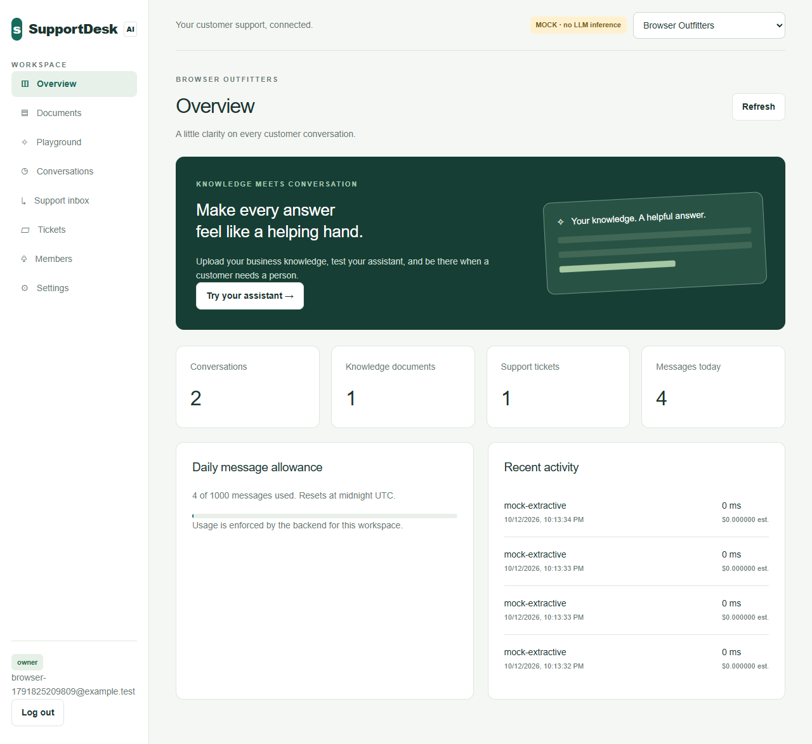
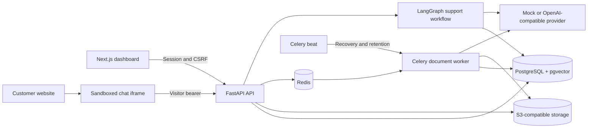

# SupportDesk AI

**Turn business knowledge into customer support, with cited answers and a human ready to take over.**

SupportDesk AI is a full-stack, multi-tenant customer support SaaS application. Businesses upload their policies, test a support assistant, embed a chat widget on their website, and manage conversations, tickets, and human handoffs from one dashboard.

The repository includes a Next.js dashboard, a FastAPI API, a sandboxed JavaScript widget, background document ingestion, and a Docker Compose development stack.

> **Model modes:** The default `MODEL_MODE=mock` performs deterministic retrieval and text extraction. It makes no LLM calls. Configure an OpenAI-compatible provider to enable model-generated answers. Local verification and infrastructure checks are documented separately in [Verification](docs/verification.md).



[Quick start](#quick-start) · [Features](#features) · [Architecture](#architecture) · [Configuration](#configuration) · [Development](#development) · [Documentation](#documentation)

## Features

| Capability           | What is included                                                                                                                                         |
| -------------------- | -------------------------------------------------------------------------------------------------------------------------------------------------------- |
| Workspace management | Separate businesses, workspace switching, and owner, administrator, and support-agent roles.                                                             |
| Knowledge documents  | PDF, UTF-8 TXT, and Markdown uploads; background extraction, chunking, embedding, status tracking, replacement, and deletion.                            |
| Answers with sources | Retrieval from active document versions, source-page references, bounded citation excerpts, and a fallback when evidence is insufficient.                |
| Embedded support     | A configurable iframe widget with bot name, welcome message, theme color, exact permitted website origins, and visitor-scoped history.                   |
| Human handoff        | Requests for a person, a support inbox, exclusive conversation claims, agent replies delivered through polling, and return to bot mode.                  |
| Support tickets      | Explicit customer consent, persisted ticket references, idempotent creation, assignment, and status updates.                                             |
| Usage visibility     | Conversation/document/ticket counts, daily message quotas, latency, model identity, and configurable token-cost estimates.                               |
| Authentication       | Expiring HttpOnly sessions, Argon2 password hashes, CSRF checks, membership authorization, and rate limiting.                                            |
| Operations           | Alembic migrations, dependency health checks, request IDs, ingestion recovery, retention cleanup, lockfiles, and a GitHub Actions verification workflow. |

Workspace owners can add already-registered users as members. Email invitations and password-reset delivery are outside this version.

## Architecture



The chat workflow explicitly loads context, routes the request, retrieves evidence, generates an answer, validates citations, verifies authorized actions, and persists the result. Ticket creation and handoff require structured customer actions; model output cannot authorize them.

Responses use server-sent events (SSE) after the complete answer has been validated and committed. This is response streaming, rather than raw provider-token streaming. See [Architecture](docs/architecture.md) and [Request flows](docs/request-flows.md) for transaction boundaries, tenant isolation, and the event contract.

### Technology stack

| Layer                   | Technologies                                                           |
| ----------------------- | ---------------------------------------------------------------------- |
| Dashboard               | Next.js 16, React 19, TypeScript, Tailwind CSS 4                       |
| API and workflow        | Python 3.10, FastAPI, Pydantic, SQLAlchemy, LangGraph                  |
| Database and migrations | PostgreSQL 16, pgvector, Alembic                                       |
| Background processing   | Celery, Celery beat, Redis                                             |
| Original documents      | S3-compatible object storage; MinIO in local Compose                   |
| Widget                  | Vanilla JavaScript and a sandboxed iframe                              |
| Quality checks          | pytest, Ruff, mypy, ESLint, TypeScript, Playwright                     |
| Packaging               | Docker Compose, pip lockfile, pnpm lockfile, standalone Next.js output |

Dependency resolutions are committed in [backend/requirements.lock](backend/requirements.lock) and [frontend/pnpm-lock.yaml](frontend/pnpm-lock.yaml).

## Quick start

### Prerequisites

- Git and access to this repository.
- Docker Desktop or Docker Engine with Compose v2.
- A running Docker daemon and approximately 4 GB of available memory.
- Ports `3000`, `3001`, `5432`, `6379`, `8000`, `9000`, and `9001` available on the local machine.

Clone the repository, then create your local configuration:

```sh
git clone https://github.com/MutteUllah/supportdesk-ai.git
cd supportdesk-ai
cp .env.example .env
```

On PowerShell, use `Copy-Item .env.example .env`. Open `.env` and set `DEMO_PASSWORD` to a unique password of at least 12 characters if you want the sample accounts. Then start the services:

```sh
docker compose up --build -d --wait
docker compose exec api python -m app.seed
```

Compose applies migrations and creates the local storage bucket. The explicit seed command creates two fictional businesses and queues their policy documents through Celery. Wait until their documents are marked **ready/searchable**. Seeding is repeatable and disabled in production; it does not reset an existing account's password.

The first build compiles the pinned MinIO release from official Go source because its previous container distribution is unavailable. Allow several minutes for this build; later local builds can reuse Docker's cache. Bucket initialization uses the backend's S3 client.

| Service                             | Local address                                                                 |
| ----------------------------------- | ----------------------------------------------------------------------------- |
| Business dashboard                  | [localhost:3000](http://localhost:3000)                                       |
| Separate widget demo website        | [localhost:3001](http://localhost:3001)                                       |
| Interactive API documentation       | [localhost:8000/docs](http://localhost:8000/docs)                             |
| OpenAPI schema                      | [localhost:8000/openapi.json](http://localhost:8000/openapi.json)             |
| API liveness / dependency readiness | [health](http://localhost:8000/health) / [ready](http://localhost:8000/ready) |
| Local MinIO console                 | [localhost:9001](http://localhost:9001)                                       |

Use `localhost` consistently in the browser: `127.0.0.1` is a different origin. The MinIO console uses the local credentials in `.env`.

### Try the complete support flow

1. Sign in as `northstar@example.test` or `cedar@example.test` using your `DEMO_PASSWORD`. Alternatively, register your own account and create a workspace.
2. Open **Documents** and confirm ingestion has completed. Northstar's demo policy specifies shipping in **3 business days** and returns within **30 days**. Cedar & Clay specifies **12 business days**, **7-day** returns, and no returns for custom items.
3. Open **Playground**, start a conversation, ask about shipping, and open the source citation. Sign into the other demo account to compare its business's policies.
4. Open **Settings**, copy the public workspace ID from the embed snippet, and paste it into the separate demo website at `http://localhost:3001`. Seeded workspaces permit that exact origin.
5. Send a visitor message, create a ticket, or request a human. In the dashboard's **Support inbox**, claim the conversation and reply. The widget polls for human replies; release the conversation to return it to the bot.

For your own website, add its exact origin in **Settings** and copy the generated embed snippet. Its structure is:

```html
<script
  src="http://localhost:8000/widget/loader.js"
  data-workspace="YOUR_PUBLIC_WORKSPACE_ID"
  defer
></script>
```

Use your HTTPS API URL for a deployed website. The public workspace ID is an embed identifier, not a dashboard credential.

### Useful local commands

```sh
docker compose ps
docker compose logs -f api worker
docker compose down
```

`docker compose down` keeps the named data volumes. Adding `-v` deletes the local database, broker, and object-storage volumes.

## Configuration

Start with [.env.example](.env.example). Backend settings are defined in [backend/app/config.py](backend/app/config.py); Compose supplies service-network database, Redis, and MinIO addresses inside containers.

| Variable                                                      | Purpose / default                                                                                             |
| ------------------------------------------------------------- | ------------------------------------------------------------------------------------------------------------- |
| `ENVIRONMENT`                                                 | `development`, `test`, or `production`; default `development`.                                                |
| `DATABASE_URL`, `REDIS_URL`                                   | Database and broker connections for processes running outside Compose.                                        |
| `POSTGRES_PASSWORD`, `MINIO_ROOT_USER`, `MINIO_ROOT_PASSWORD` | Local Compose service credentials. Replace example values for deployment.                                     |
| `DASHBOARD_ORIGIN`, `API_ORIGIN`                              | Exact dashboard/API origins; default `http://localhost:3000` and `http://localhost:8000`.                     |
| `NEXT_PUBLIC_API_URL`                                         | Public API address compiled into the frontend at build time. Never place secrets in `NEXT_PUBLIC_` variables. |
| `MODEL_MODE`                                                  | `mock` for deterministic extraction; `openai` for compatible provider calls.                                  |
| `MODEL_BASE_URL`, `MODEL_API_KEY`                             | Provider base URL and server-side credential for `openai` mode.                                               |
| `CHAT_MODEL`, `EMBEDDING_MODEL`, `EMBEDDING_DIMENSIONS`       | Provider model identifiers and vector size. Default dimensions: `1536`.                                       |
| `CHUNK_SIZE`, `CHUNK_OVERLAP`, `RETRIEVAL_COUNT`              | Document chunking and retrieval; defaults `1000`, `150`, and `4`.                                             |
| `RETRIEVAL_MAX_DISTANCE`                                      | Real-provider cosine-distance threshold; default `0.55`. Calibrate against your policies.                     |
| `STORAGE_MODE`, `S3_*`                                        | Object-storage mode, endpoint, credentials, and private bucket. Compose uses MinIO.                           |
| `DAILY_CHAT_QUOTA`, `RETENTION_DAYS`                          | New-workspace daily quota and conversation retention; defaults `1000` and `90`.                               |
| `INPUT_COST_PER_MILLION`, `OUTPUT_COST_PER_MILLION`           | Cost-estimation rates. Zero means **unpriced**, not free inference.                                           |
| `DEMO_PASSWORD`                                               | Required only for explicit demo seeding; at least 12 characters.                                              |

The default upload limit is 10 MiB and extracted text is capped at 500,000 characters. PDFs must contain extractable text; scanned PDFs/OCR are not supported.

### Enable a real model provider

Set `MODEL_MODE=openai` and configure `MODEL_API_KEY`, `MODEL_BASE_URL`, `CHAT_MODEL`, and `EMBEDDING_MODEL` on the backend. The adapter requires compatible `/embeddings` requests with `dimensions` and `/chat/completions` requests with JSON-object responses. See [Operations](docs/operations.md) for timeouts, retries, and deployment settings.

Changing model mode, embedding model, or dimensions changes the embedding identity. Existing workspaces reject indexing and retrieval with a different identity. Restore the previous settings or create a new workspace and upload its sources again. An automated in-place reindex switch is not provided.

With Python dependencies installed and provider configuration available, run the optional connectivity check:

```sh
python scripts/real_provider_smoke.py
```

This makes provider requests that may incur charges. It checks connectivity and a small cited answer; evaluate real-model accuracy and injection behavior against your own business policies separately.

## Development

The Dockerfiles and CI use Python 3.10, Node.js 24, and pnpm 11.25.0. From the repository root:

```sh
python -m venv .venv
```

Activate with `source .venv/bin/activate` on POSIX shells or `.\.venv\Scripts\Activate.ps1` in PowerShell, then install dependencies:

```sh
python -m pip install -r backend/requirements.lock
corepack enable
corepack prepare pnpm@11.25.0 --activate
pnpm --dir frontend install --frozen-lockfile
```

For browser development without Docker, run each command in a separate terminal from the repository root, with the Python environment activated where needed:

```sh
python scripts/local_test_server.py
```

```sh
pnpm --dir frontend dev
```

```sh
python -m http.server 3001 --bind 127.0.0.1 --directory demo-site
```

This convenience setup uses SQLite, local files, inline ingestion, in-memory rate limits, and mock models. It binds the API to loopback; its test adapters are prohibited outside `ENVIRONMENT=test`. Register an account in the dashboard to begin. Use Compose to exercise actual PostgreSQL, Redis, MinIO, and workers.

### Quality checks

```sh
python -m pytest -q backend
python -m ruff check backend scripts
python -m ruff format --check backend scripts
python -m mypy --config-file backend/pyproject.toml backend/app
pnpm --dir frontend lint
pnpm --dir frontend typecheck
pnpm --dir frontend build
```

With the dashboard, API, and demo website running:

```sh
pnpm --dir frontend exec playwright install chromium
pnpm --dir frontend test:e2e
```

Set `BROWSER_EXECUTABLE` to use an installed compatible browser. Run the actual worker/storage smoke only against the Compose stack:

```sh
python scripts/compose_smoke.py
```

Backend tests default to a disposable SQLite database. `TEST_DATABASE_URL` selects a disposable PostgreSQL database and enables the PostgreSQL concurrency cases. **The fixtures drop application tables: never select a database containing data you need to keep.** See [Verification](docs/verification.md) for commands, executed results, and environment-dependent checks.

The [GitHub Actions workflow](.github/workflows/ci.yml) passed its backend/frontend checks and real Compose acceptance in [this verified run](https://github.com/MutteUllah/supportdesk-ai/actions/runs/38733881701): **34 PostgreSQL tests**, a worker/S3/Redis/pgvector smoke, and **one browser scenario**. Models remained in mock mode. See [Verification](docs/verification.md) for the exact code revision, historical local results, and remaining limits.

## Repository structure

```text
.
├── backend/
│   ├── app/                 # API, auth, models, workflow, ingestion, providers
│   ├── migrations/          # Versioned Alembic schema changes
│   └── tests/               # Acceptance, failure, and PostgreSQL concurrency cases
├── frontend/
│   ├── app/                 # Next.js dashboard
│   ├── scripts/             # Standalone production startup helper
│   └── tests/               # Playwright acceptance scenario
├── widget/                  # Embed loader and visitor chat iframe
├── demo-site/               # Separate website for widget integration
├── docker/                  # Pinned MinIO source-build container
├── docs/                    # Architecture, operations, evidence, and screenshots
├── scripts/                 # Local test server and smoke/packaging helpers
├── .github/workflows/       # CI configuration
├── .env.example             # Documented local configuration
└── docker-compose.yml       # Local service stack
```

## Production scope and current limits

This repository is an implemented application with local and real-infrastructure CI verification. No cloud deployment or real-provider evaluation has been performed. Review the current [verification record](docs/verification.md) before relying on infrastructure-specific behavior.

- Production requires HTTPS dashboard/API origins on the same site, PostgreSQL with pgvector, configured private S3 storage, Redis, a worker, and one beat instance. Local Compose credentials and loopback bindings are development defaults. See the [deployment guide](docs/operations.md#production-deployment).
- Chat holds a workspace lock during generation to serialize quota accounting; throughput within one workspace is limited. Retrieval uses exact tenant-filtered searches, and conversation/ticket lists are capped at 200.
- Citation identifiers are validated against retrieved evidence. That does not prove every generated sentence is supported; real-model answers still require evaluation.
- Widget origin restrictions complement visitor tokens and quotas. A client-supplied origin is not authentication against nonbrowser clients, and third-party storage restrictions can affect visitor continuity.
- Billing/subscriptions, email delivery, password resets, order-system integrations, OCR, malware scanning, account export/deletion workflows, and automated high-availability provisioning are outside this version.

## Documentation

| Guide                                           | Contents                                                                          |
| ----------------------------------------------- | --------------------------------------------------------------------------------- |
| [Architecture](docs/architecture.md)            | Component responsibilities, trust boundaries, concurrency, and persistence.       |
| [Request flows](docs/request-flows.md)          | Actual login, ingestion, chat/SSE, ticket, visitor, and handoff flows.            |
| [Operations](docs/operations.md)                | Configuration, production deployment, failures, backup/restore, and retention.    |
| [Verification](docs/verification.md)            | Executed checks, browser coverage, known gaps, and next validation steps.         |
| [Learning plan](docs/learning-plan.md)          | A guided four-day tour of the codebase.                                           |
| [PostgreSQL schema](docs/schema-postgresql.sql) | Generated SQL reference; Alembic migrations remain the executable schema history. |
| [Contributing](CONTRIBUTING.md)                 | Local workflow, meaningful validation, and pull request expectations.             |
| [Security](SECURITY.md)                         | Private vulnerability reporting and security-sensitive development guidance.      |

The [mobile screenshot](docs/screenshots/dashboard-mobile.png) complements the desktop preview above. Screenshots show fictional test data in mock mode.
