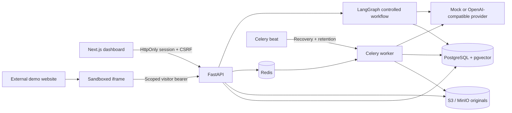

# Architecture

SupportDesk AI uses one Python application in three process roles: API, document worker, and periodic maintenance. The Next.js dashboard and small vanilla-JavaScript widget use the same authorization and conversation APIs.

## Responsibilities

`backend/app/main.py` is the transport boundary: request validation, session dependencies, membership checks, uploads, SSE framing, widget delivery, and human support APIs. `models.py` defines the 15 core tables and composite tenant foreign keys. `schemas.py` defines inputs. `security.py` owns password hashing, opaque token hashing, CSRF, membership checks, and Redis rate limits.

`ingestion.py` owns extraction, chunking, embedding, active-version swaps, job retries, recovery, and cleanup. Document records serve as durable job intents: queued or stale processing versions are redispatched by maintenance. A deletion tombstone immediately excludes retrieval and revokes sources; maintenance removes objects first, then relational data. Cleanup is retried if object storage is unavailable.

`chat.py` builds a linear LangGraph with explicit stages. It deliberately does not use an autonomous tool-calling agent. The customer chooses ticket or handoff actions using structured UI controls. Model-generated text cannot authorize an action. `provider.py` implements one configurable OpenAI-compatible provider plus a clearly identified extractive mock.

`frontend/app/page.tsx` contains the dashboard views. `widget/loader.js` only creates a launcher and iframe. The iframe runs `widget/app.js`, stores a visitor-scoped bearer in its own origin's localStorage when available, and polls for human replies. Dashboard session tokens are never placed in localStorage.

## Trust boundaries

- A workspace public ID is an embed identifier, never a dashboard credential.
- Every workspace API authorizes the authenticated user through membership. Visitor APIs authorize the session's workspace and the conversation's visitor ID. Sources traverse citation → message → conversation before revealing at most 500 characters.
- Workspace foreign keys plus composite keys on messages, citations, versions, chunks, tickets, tool executions, and visitors constrain tenant relationships in the database. `Document.active_version_id` is an application-managed pointer; writes occur only under the document lock and use that document's verified version.
- Document text and customer text are untrusted. The provider system instruction disallows instruction-following from evidence. Citation IDs are checked against retrieved chunks. Ticket authorization is entirely outside the provider, so even a malicious answer cannot execute a tool.
- Exact permitted origins and `frame-ancestors` constrain normal browser embedding. The API cannot authenticate an arbitrary website using a client-supplied origin. A nonbrowser attacker can spoof it. Visitor bearer scoping, Redis limits, and database quotas are separate controls; origin checks alone do not prevent abuse.
- React text nodes and DOM `textContent` render model/document content literally. Raw HTML is never rendered. Markdown is safely displayed as text in this version, without rich formatting.

## Transactions and concurrency

Chat takes the workspace lock, then the conversation lock. This serializes daily quota accounting and same-conversation request keys. Provider generation occurs while these locks are held. That is intentionally easy to reason about, but limits throughput within one workspace. A production scale-up should use leased request records and optimistic revision checks rather than simply dropping locks.

Human claim/release/reply also locks the conversation. A claim waits for any current generation transaction; after ownership changes, new chat requests save customer messages without producing bot answers. Streaming rechecks the conversation revision between chunks and stops if ownership changes. Text already delivered before takeover cannot be recalled.

An ingestion attempt locks the document while extracting/indexing and committing the active pointer. A newer ready version cannot be displaced by an older job. Failed replacement transactions roll back; the old active pointer remains. Exact tenant-filtered vector retrieval is used rather than an approximate global vector index. The first release favors transparent isolation over very large-corpus search performance.

Ticket creation and verified tool execution are in one transaction. The `(conversation_id, action_key)` unique constraint and conversation lock deduplicate retries. The server checks the ticket row and marks the execution verified before committing and emitting a success message.

## Persistence and streaming

PostgreSQL owns conversation history. LangGraph is compiled without process-memory checkpoints; each invocation loads a bounded recent history from SQL. Provider context is limited to ten recent user/assistant messages and the configured retrieved chunks.

SSE is **post-validation response streaming**, not raw provider token streaming. The complete provider response is parsed and citations validated, actions verified, and transaction committed before `delta` frames are emitted. This prevents sending unverified tool-success claims. The first `status` event is immediate; provider timeouts are bounded. See request-flows for the event contract and disconnection behavior.

## Documentation consulted

- [SQLAlchemy composite foreign keys](https://docs.sqlalchemy.org/en/20/core/constraints.html)
- [LangGraph graph API](https://docs.langchain.com/oss/python/langgraph/graph-api)
- [Celery task retries](https://docs.celeryq.dev/en/stable/userguide/tasks.html)
- [pgvector Python integration](https://github.com/pgvector/pgvector-python)
- [Next.js installation](https://nextjs.org/docs/app/getting-started/installation)

Resolved dependency versions are captured in `backend/requirements.lock` and `frontend/pnpm-lock.yaml`. The initial migration is frozen SQLAlchemy operations and does not import changing application models.
